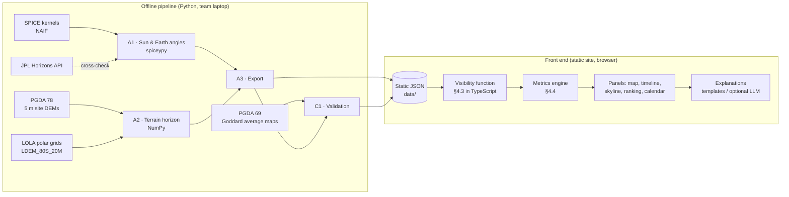

# LunaWise — Architecture

> **"The launch got delayed. Now what?"**
> A web tool that compares lunar south pole landing sites and landing dates by when the Sun and Earth are actually visible above the real terrain.

**Team OPUS** · NASA Space Apps Challenge 2026 · · Kolkata local event · 14–15 November 2026

---

## 1. Team

| # | Member | Track (proposed) | Owns |
|---|---|---|---|
| 1 | **Avasyu Roy** | Pipeline lead | Sun and Earth angles (A1), SPICE setup, JSON export (A3) |
| 2 | **Debarghya Bose** | Pipeline | Terrain horizon calculator (A2), DEM reading, near/far-field sampling |
| 3 | **Soumik Bhuniya** | Front end lead | App shell, control bar, URL state, map (B1), deployment (E1) |
| 4 | **Debanik Dey** | Front end | Timeline (B2), skyline view (B3), comparison (B5), calendar (D2) |
| 5 | **Aheli Jana** | Validation | Horizons cross-checks, validation table vs NASA Goddard (C1), Python ↔ JS test |
| 6 | **Ashika Ghosh** | Story and submission | Methods page, credits, AI-use disclosure, 30-second demo, project page |

The specification leaves the role split open, so this table is a starting proposal. Reassign freely; the only firm rule is that **the strongest Python person is on the pipeline from the first hour**, because every other feature reads its output.

---

## 2. What the product answers

The user is a planner of a commercial robotic lander mission (CLPS = Commercial Lunar Payload Services). The one question LunaWise answers:

> *"The launch slipped by N days. Which sites still work, which fail, and why?"*

Near the lunar south pole the Sun never climbs more than about 1.5° above an ideal horizon, so a ridge 100+ km away decides whether a site is lit. Earth bobs up and down near 0° longitude and drops behind terrain periodically. A site's usefulness therefore depends on **the date**, **the mast height**, and **the real skyline**, and all three are computed, not guessed.

### Non-negotiable rules

1. Every number on screen comes from the computation in §4. No invented scores, no "mission success %".
2. An LLM may *phrase* results. It never produces a number, cause or recommendation that is not in the computed data it was given.
3. The front end runs entirely from precomputed static JSON. No backend at demo time.
4. Never suggest "move N km" unless that alternative point was actually computed.
5. If the official challenge statement conflicts with this document, the statement wins.

---

## 3. System overview

LunaWise is split into two halves that meet at a fixed file contract.



**Why this split:** the expensive work (ephemeris and 1.1 million terrain lookups per site) happens once, offline. What changes with user input (mast height, comms margin, delay, thresholds) is cheap arithmetic on stored arrays, so the browser does it instantly with no server.

---

## 4. Offline pipeline

### 4.1 Sun and Earth angles (A1)

For each site and each hour from **2026-11-01 to 2028-12-31 UTC** (~19,000 rows):

1. Load kernels: `moon_pa_de440_200625.bpc`, `moon_de440_220930.tf`, `pck00011.tpc`, a planetary ephemeris (`de440s.bsp`, to confirm), leap seconds (`naif0012.tls`, to confirm).
2. Build the observer in the `MOON_ME` frame from latitude, longitude and radius (reference radius + terrain elevation + mast height).
3. Get the Sun (body 10) and Earth (body 399) relative to the observer with light-time and stellar aberration correction. SPICE `azlcpo` does this directly.
4. Store azimuth (clockwise from north), elevation (above local horizontal) and angular radius (computed from body radius and distance, never hard-coded).

Cross-checked against **JPL Horizons** at five or more timestamps per body: agreement within 0.1°.

### 4.2 Terrain horizon profile (A2)

The method follows Mazarico et al. (2011): compute the horizon angle in many directions once, store it, then test any Sun or Earth position against it.

- **720 azimuths** (every 0.5°).
- Sample along the great circle out to **≥ 200 km** (Mons Malapert sits ~137 km from the Shackleton rim).
- Step size grows with distance: DEM pixel size near the site, then ~0.5% of distance.
- **Near field:** PGDA 5 m site DEM. **Far field:** coarse LOLA polar grid. Bilinear interpolation in the DEM's own polar stereographic coordinates (projection read from file metadata, never hard-coded).
- Curvature handled exactly in 3D:

```
up    = unit vector from Moon centre to observer
P0    = (R + h_site + mast) * up
P     = (R + h_sample) * unit(lat_sample, lon_sample)
d     = P - P0
angle = asin( dot(d, up) / |d| )
horizon[az] = max(angle over all samples on that azimuth)
```

Computed for mast heights of **2 m, 5 m and 10 m**.

### 4.3 Export (A3)

Writes one JSON file per site plus an index, the hillshade base map, and the validation table (see §6).

### 4.4 Validation (C1)

The validation run uses the same 18.6-year span and near-zero mast height as NASA Goddard's PGDA product 69 averages, so the comparison is like with like. Differences are reported in percentage points for every site. This is the project's main proof of the *validity* judging criterion.

---

## 5. The core computation shared by both halves

Everything reads one function: how much of a disc clears the horizon.

```
x = (el - H) / r          el = body centre elevation
                          r  = angular radius
                          H  = terrain horizon at the body's azimuth
fraction = 1                                         if x >= 1
fraction = 0                                         if x <= -1
fraction = 1 - (acos(x) - x*sqrt(1 - x*x)) / pi      otherwise
```

- **Sun** (~0.53° wide): `H` interpolated at the Sun's azimuth.
- **Earth** (~1.9° wide, ~4 azimuth bins): integrate column by column across the disc.
- **Visible** = fraction > 0 (matches Goddard's definition, which they call slightly optimistic for radio).
- **Communication margin (D5):** Earth counts as usable only when `el >= H + margin` (0°, 1°, 2°).

This function exists **twice**: in Python (reference) and in TypeScript (front end). A unit test confirms both agree within 0.001 on 1,000 random inputs.

### Metrics for a mission window (start `t0`, duration `D` days)

| Metric | Definition |
|---|---|
| Sunlit fraction | Mean Sun fraction over the window |
| Earth-contact fraction | Share of hours with Earth usable |
| Longest dark gap | Longest run of hours with Sun fraction = 0 |
| Longest Earth gap | Longest run of hours with Earth not usable |
| Hours to first sunset / Earth-set | From `t0` |
| Operations window (stretch) | Hours with both Sun and Earth usable |

Mast height, window and time step are always printed beside these numbers.

---

## 6. Data contract (`data/`)

Agreed **before** anyone writes code, so the front end can build on mock data while the pipeline runs.

| File | Contents |
|---|---|
| `data/sites.json` | Index: id, name, lat, lon, elevation, map pixel position, DEM used |
| `data/site/{id}.json` | Horizon profiles + hourly Sun and Earth angles for one site (~1 MB) |
| `data/zone/{id}.json` | Horizon profiles for 30–50 landing-zone points around one site (D3) |
| `data/validation.json` | Team values vs NASA Goddard values per site (C1) |
| `data/basemap.png` | Hillshade of the south pole rendered from the DEM |

Site file shape (values filled from the DEM, never from memory):

```json
{
  "id": "shackleton_rim",
  "name": "Shackleton rim",
  "lat": 0.0, "lon": 0.0, "elev_m": 0.0,
  "dem": { "near": "PGDA 78 Site04, 5 m", "far": "LDEM_80S_20M", "search_km": 200 },
  "azimuth_step_deg": 0.5,
  "horizon_deg": { "2": [], "5": [], "10": [] },
  "time": { "start": "2026-11-01T00:00:00Z", "step_h": 1, "n": 19000 },
  "sun":   { "az": [], "el": [], "radius_deg": [] },
  "earth": { "az": [], "el": [], "radius_deg": [] }
}
```

Angles rounded to 0.01°.

**Candidate sites** (catalogued names only): Shackleton rim, Connecting ridge, de Gerlache rim, Malapert massif, Leibnitz beta plateau (Mons Mouton), Nobile rim 1, Nobile rim 2, Haworth, Shoemaker.

---

## 7. Front end

Single-page app reading only the static files. Suggested stack: **React + Vite + TypeScript**, Plotly or D3 for charts.

```
┌──────────────────────────────────────────────────────────────────┐
│ Control bar: date · duration · delay 0–60 d · mast 2/5/10 m ·   │
│              comms margin 0/1/2° · requirement thresholds        │
├───────────────────────┬──────────────────────────────────────────┤
│                       │ Timeline: Sun bar · Earth bar · metrics  │
│   Map (hillshade)     ├──────────────────────────────────────────┤
│   site markers        │ Skyline: 360° horizon + Sun & Earth discs│
│   pass / fail         ├──────────────────────────────────────────┤
│                       │ Ranking · Failure message · Comparison   │
└───────────────────────┴──────────────────────────────────────────┘
                     Calendar heatmap · Landing zone · Methods page
```

| Panel | Feature | What it does |
|---|---|---|
| Control bar | — | Every control updates every panel instantly; all settings live in the URL so a scenario is a shareable link |
| Map | B1 | Click selects a site; markers coloured pass/fail |
| Timeline | B2 | Sun-visible and Earth-usable bars; requirement-breaking gaps highlighted |
| Skyline | B3 | Terrain silhouette with Sun and Earth at true angular size; time scrubber |
| Delay + comparison | B4, B5 | Original vs delayed plan, same axis, signed differences |
| Ranking | B6, D1 | Pass/fail and margin per requirement, delay tolerance; "among N candidate sites" |
| Failure message | B7, B8 | First constraint violation: time, which limit, body azimuth, blocking terrain angle |
| Calendar | D2 | Site × start date over 12 months, coloured by requirements met |
| Landing zone | D3 | ~37 points around the target; "X% of this zone meets your requirements" |
| Methods | E1 | Sources, formulas, assumptions, limits, AI disclosure, validation table |

**Explanations (B8)** start as fixed sentence templates filled from computed values. If an LLM is used, it receives only the computed values as JSON, is told to use no other numbers, and the UI shows "AI-phrased from computed data".

**Limits printed in the UI:** DEM resolution and interpolation, observer height, one-hour time step, far-field search distance, and that "Earth usable" is geometric line of sight, not a radio link budget.

---

## 8. Repository structure

```
lunawise/
├── README.md
├── ARCHITECTURE.md                 ← this file
├── pipeline/                       # Python, runs offline
│   ├── pyproject.toml
│   ├── config.yaml                 # paths to kernels and DEMs, time range, sites
│   ├── kernels/                    # SPICE kernels (git-ignored, see meta.tm)
│   │   └── meta.tm
│   ├── dems/                       # PGDA / LOLA files (git-ignored)
│   ├── lunawise/
│   │   ├── __init__.py
│   │   ├── ephemeris.py            # A1  Sun & Earth az/el/radius
│   │   ├── horizons_check.py       # A1  JPL Horizons cross-check
│   │   ├── dem.py                  # A2  DEM reading, projection, bilinear sampling
│   │   ├── horizon.py              # A2  720-azimuth horizon profile
│   │   ├── visibility.py           # §4.3 disc fraction (reference implementation)
│   │   ├── metrics.py              # §4.4 window metrics
│   │   ├── export.py               # A3  JSON writers
│   │   ├── basemap.py              # hillshade PNG
│   │   └── validation.py           # C1  vs PGDA 69
│   ├── scripts/
│   │   ├── run_site.py
│   │   └── run_all.py
│   └── tests/
│       ├── test_ephemeris.py       # Sun elevation bound, Sun & Earth motion
│       ├── test_horizons.py        # SPICE vs Horizons within 0.1°
│       ├── test_horizon.py         # Shackleton skyline sanity
│       └── test_visibility.py      # Python ↔ JS agreement
├── web/                            # React + Vite + TypeScript
│   ├── public/data/                # ← pipeline output copied here
│   ├── src/
│   │   ├── lib/visibility.ts       # §4.3, must match Python
│   │   ├── lib/metrics.ts
│   │   ├── state/url.ts            # scenario ↔ URL
│   │   ├── panels/                 # Map, Timeline, Skyline, Ranking, Calendar, Zone
│   │   └── pages/Methods.tsx
│   └── tests/
├── data-mock/                      # schema-valid fake JSON for front-end day 1
└── docs/
    ├── validation.md
    └── credits.md
```

---

## 9. Build order

Each tier starts only when the one before it works.

| Tier | Items | Done when |
|---|---|---|
| **A · Engine** | A1 angles · A2 horizon · A3 export | Site files exist for 8+ sites; all §10 engine tests pass |
| **B · Core** | B1–B8 | One scenario runs end to end from static files |
| **C · Proof** | C1 validation table | Differences from Goddard stated for 8+ sites |
| **D · Differentiators** | D1 delay tolerance · D2 calendar · D5 comms margin · D3 zone · D4 height | Keep D1, D2, D5 if time is short |
| **E · Deploy** | Static site, shareable URLs, open dataset, methods page | Link opens logged-out |
| F · Stretch | Battery, student mode, relay toggle, IM-2 case, etc. | Only after A–E |

**Minimum to submit:** A + B + C.

**Fallback (Saturday 23:00):** if no terrain horizon passes the skyline test, ship Sun and Earth angles against a smooth horizon, show the Goddard average maps for terrain context, and print the limitation on screen.

---

## 10. Acceptance tests

| Test | Pass condition |
|---|---|
| Sun elevation range | Centre elevation ≤ ~1.54° + (90° − \|lat\|) |
| Sun motion | Azimuth sweeps 360° in ~29.5 days |
| Earth motion | Stays in a small az/el box toward 0° longitude, bobbing |
| SPICE vs Horizons | Within 0.1° at 5+ timestamps per body |
| Skyline sanity | Shackleton rim profile shows a high feature toward Earth (Mons Malapert, ~137 km) |
| Python vs JavaScript | Visibility fraction agrees within 0.001 on 1,000 random inputs |
| Published averages | Difference from PGDA 69 reported per site |
| Literature check | Connecting ridge at 2 m near 92.27% (Gläser et al. 2014) |
| End to end | Site + date + 14-day delay runs with no backend and no network |

---

## 11. Data sources and credits

| Data | Source | Role |
|---|---|---|
| 5 m site DEMs | NASA Goddard PGDA product 78 | Near-field terrain, site coordinates |
| `LDEM_80S_20M`, `LDEM_75S_120M` | LOLA PDS node | Far-field skyline to 200+ km |
| Average Sun / Earth visibility maps | NASA Goddard PGDA product 69 | Validation answer key |
| SPICE kernels | NASA NAIF | Sun and Earth positions |
| JPL Horizons API | NASA JPL | Independent cross-check |
| LROC QuickMap, NASA Moon Trek | ACT / IM-LDI, NASA | Picking sites by eye; no numeric input |
| CSA Moon Exploration portal | Canadian Space Agency | Background only |

AI use is disclosed on the methods page: AI-generated code and text are acknowledged, and no NASA branding appears in generated content.

---

## 12. Open items before building

- [ ] Read and save the full official challenge statement; diff it against this document.
- [ ] Re-read the 2026 judging and submission guides (30 s video or ≤ 7 slides).
- [ ] Confirm ephemeris and leap-seconds file names on NAIF.
- [ ] Run the Horizons query once and parse the response.
- [ ] Read every site's coordinates from its DEM.
- [ ] Check whether QuickMap or Moon Trek already answer date-specific questions.
- [ ] Ask the local lead what pre-event work is allowed.
