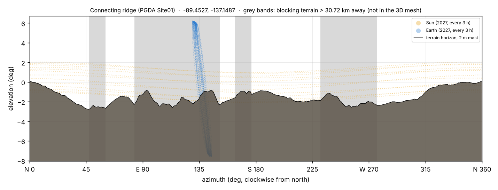
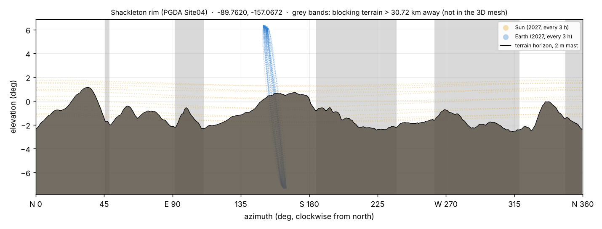
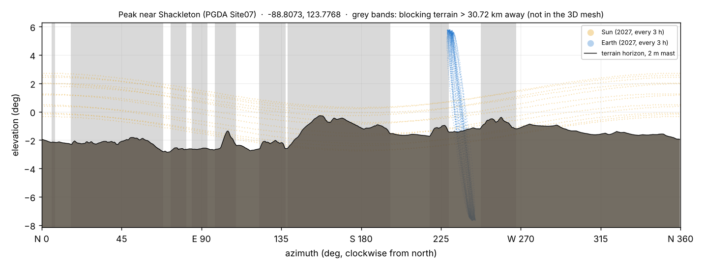
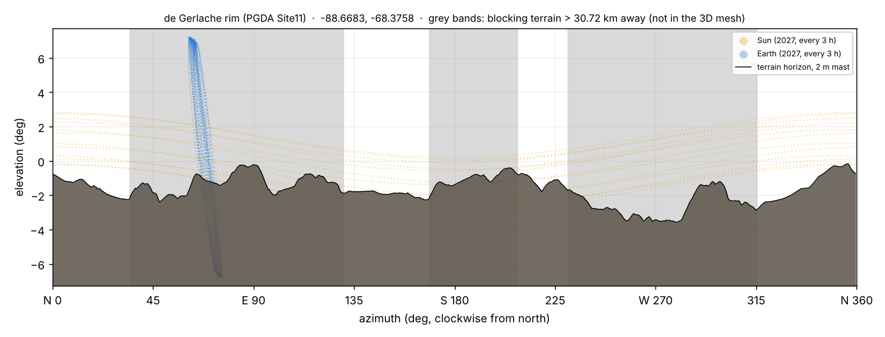
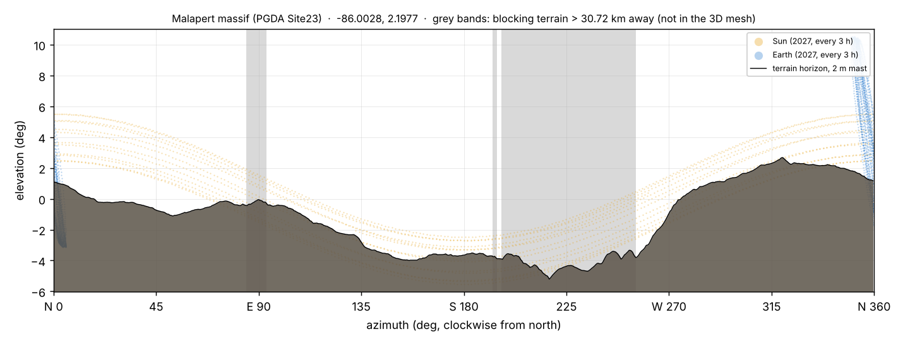

# Skyline plots (M2.1)

Generated by `Member2/pipeline/plot_skylines.py` from `data_out/` (2 m mast, 2027). Every number below is computed from the data, not typed in.

| Site | Highest ridge (az, elev, distance) | Earth azimuth range | Earth elevation range | Terrain toward Earth | Highest Sun | Horizon bins beyond 3D mesh |
|---|---|---|---|---|---|---|
| Connecting ridge (PGDA Site01) | 0.0°, 0.11°, 0.4 km | 129.4°–144.8° | -7.54° to 6.22° | -2.23° to -0.86° | 2.06° | 39% |
| Shackleton rim (PGDA Site04) | 34.5°, 1.16°, 9.5 km | 149.3°–164.7° | -7.32° to 6.37° | 0.08° to 0.67° | 1.76° | 39% |
| Peak near Shackleton (PGDA Site07) | 156.5°, -0.28°, 42.2 km | 228.4°–244.0° | -7.64° to 5.79° | -1.44° to -1.13° | 2.74° | 52% |
| de Gerlache rim (PGDA Site11) | 356.0°, -0.16°, 0.1 km | 60.7°–75.9° | -6.77° to 7.22° | -1.83° to -0.75° | 2.84° | 61% |
| Malapert massif (PGDA Site23) | 319.5°, 2.67°, 0.1 km | 349.9°–5.4° | -3.12° to 10.51° | 0.87° to 1.81° | 5.51° | 19% |

