# LunaWise: Master Project Goal & Execution Blueprint

> **Pitch Line:** *"The launch got delayed. Now what?"*  
> **Challenge:** NASA Space Apps Challenge 2026 — *Lunar Landing Site Navigator* (formerly *CLPS Lunar Mission Browser*)  
> **Team:** Team OPUS (5 Core Roles: M1–M5) · 24-Hour Build Sprint  
> **Product Core:** Static web app comparing lunar south pole landing sites via real LOLA terrain horizons and JPL Horizons ephemerides, featuring an interactive **2D Delay Dashboard** and an in-browser **3D Lander Digital Twin Simulation**.

---

## Table of Contents
1. [Executive Summary & Problem Statement](#1-executive-summary--problem-statement)
2. [Guiding Principles & Non-Negotiable Rules](#2-guiding-principles--non-negotiable-rules)
3. [System Architecture: Two Pillars, One Engine](#3-system-architecture-two-pillars-one-engine)
4. [Scope Lock, Landing Sites & NASA Data Sources](#4-scope-lock-landing-sites--nasa-data-sources)
5. [Data Contracts & Directory Specification](#5-data-contracts--directory-specification)
6. [Mathematical, Physical & Algorithmic Specifications](#6-mathematical-physical--algorithmic-specifications)
7. [The Lander Digital Twin (Simulation Specification)](#7-the-lander-digital-twin-simulation-specification)
8. [The Delay & Mission Scenario Engine](#8-the-delay--mission-scenario-engine)
9. [Team Roles & Hour-by-Hour Breakdown (M1 to M5)](#9-team-roles--hour-by-hour-breakdown-m1-to-m5)
10. [Master Timeline, Checkpoints & Staggered Breaks](#10-master-timeline-checkpoints--staggered-breaks)
11. [Contingency Plans & Prioritized Cut List](#11-contingency-plans--prioritized-cut-list)
12. [Demo Presentation Flow & Submission Checklist](#12-demo-presentation-flow--submission-checklist)
13. [Known Risks, Technical Pitfalls & Mitigations](#13-known-risks-technical-pitfalls--mitigations)

---

## 1. Executive Summary & Problem Statement

### 1.1 The Context
In robotic lunar exploration—specifically NASA's Commercial Lunar Payload Services (CLPS)—landing site selection at the lunar south pole is dominated by extreme geometry:
- The Sun never rises higher than ~1.5° to 7° above the local horizontal plane.
- The Earth hovers low on the horizon, undergoing apparent librations (~0° to a few degrees).
- A ridge or crater rim located several kilometers or even 100+ km away determines whether a solar-powered lander receives power or whether high-gain antennas maintain direct-to-Earth line-of-sight (LOS).

When a launch window slips by $N$ days, the illumination cycle (synodic lunar month $\approx 29.53$ days) and Earth visibility shift drastically. A landing site that was completely viable on the nominal launch date may immediately face a 100-hour dark period or an extended communication blackout, causing lander battery depletion or mission loss.

### 1.2 The Question LunaWise Answers
> **"If the landing slips by $N$ days, which sites still work, which fail, and when does the first failure happen?"**

### 1.3 The Core Calculation
For each target site and for every single hour across the target year:
$$\text{sun\_lit} = \text{sun\_elevation} > \text{terrain\_horizon}[\text{sun\_azimuth}]$$
$$\text{earth\_visible} = \text{earth\_elevation} > \text{terrain\_horizon}[\text{earth\_azimuth}]$$

Every visual, timeline, statistic, failure alert, and state-of-charge calculation in LunaWise is a direct derivation of these two fundamental conditions evaluated against real lunar topography.

---

## 2. Guiding Principles & Non-Negotiable Rules

### 2.1 The Three Non-Negotiable Rules
1. **Zero Hallucinated Numbers:** Every coordinate, elevation, azimuth, angle, percentage, and timestamp shown on screen originates strictly from verified offline scientific calculations or cited NASA/LOLA/JPL datasets. No arbitrary "mission success percentages" or fabricated composite scores.
2. **AI Boundary Discipline:** AI/LLMs may be used to structure code or rephrase plain-English textual explanations of computed outputs, but AI **never** creates numbers, predicts causes, or invents recommendations.
3. **Pure Static Deployment (Zero Live Backend at Demo):** The live application must be 100% client-side (Vite + React/Vanilla JS + Three.js), hosted on GitHub Pages or Vercel. It loads lightweight precomputed static JSON and binary arrays. No live queries to Horizons or external GIS servers during the demo.

### 2.2 What We Do NOT Build (Out of Scope)
- No Unreal Engine, Unity, or desktop `.exe` binaries (judges must be able to open a public link instantly on any laptop or phone without installation or login).
- No CesiumJS global sphere (we need micro-scale 5 m local topography; a global globe adds unnecessary risk and misses ridge details).
- No soil mechanics, regolith sinkage, plume impingement, or tip-over physics.
- No complex multi-layer thermal radiation or cryogenic boil-off models.
- No heuristic "Move $X$ km to the left" recommendations (unless the alternative coordinates were explicitly computed through the engine).
- No user authentication, databases, or cloud servers.

---

## 3. System Architecture: Two Pillars, One Engine

LunaWise is engineered as two co-equal pillars that draw from a single shared data engine:

```
                            [ NASA DATA SOURCES ]
                   JPL Horizons API       LOLA DEMs (5m & 20m)
                          │                       │
                          ▼                       ▼
                   angles/<site>.json     mask/<site>.json
                          │                       │
                          └───────────┬───────────┘
                                      ▼
                               [ OFFLINE ENGINE ]
                                  combine.py
                                      │
              ┌───────────────────────┴───────────────────────┐
              ▼                                               ▼
     [ PILLAR 1: DASHBOARD ]                       [ PILLAR 2: SIMULATION ]
   • 2D Site Selection & Ranking                 • 3D Lander Digital Twin (Three.js)
   • Sun & Earth Timeline Bars                   • Mode A: First-Person Skyline View
   • Delay Slider (0 to 30 days)                 • Real-time Horizon Mask Line Overlay
   • First-Failure Plain-Text Banner             • Directional Sun/Earth Sky Disks
   • Mission Duration & Requirements             • Mode B: Orbital Overview & Shadows
   • Battery SoC & Comms Gap Analysis            • Mode C: Scenario Replay & Time Jump
              │                                               │
              └───────────────────────┬───────────────────────┘
                                      ▼
                 [ INDEPENDENT CROSS-CHECK: raycast.js ]
              Web Worker executes client-side raycast on
              heightmap to verify agreement with Python mask
```

### Pillar 1: 2D Delay & Mission Dashboard
- Fast, intuitive, data-dense interface for the mission planner.
- Interactive timeline bars showing Sun illumination and Earth LOS over the mission duration window.
- Sliders for **Mission Start Date**, **Launch Delay ($N$ days)**, and **Mission Duration (days)**.
- User-customizable pass/fail thresholds (Minimum Sun %, Maximum Night Duration, Maximum Comm Gap).
- Dynamic site ranking based on remaining margins after delay.

### Pillar 2: 3D Lander Digital Twin (Simulation)
- Interactive Three.js scene placing the user directly at the lander's mast height ($2\text{ m}$) on the real lunar surface.
- Renders the local 5 m terrain and far-field 20 m terrain out to $60+\text{ km}$ (Mons Malapert, crater rims).
- Overlays the Python engine's 360° horizon mask line directly over the rendered 3D ridge to visually prove geometric consistency.
- Features an **independent client-side ray caster** (`raycast.js`) executed in a background Web Worker, calculating ray-terrain intersections on the fly and reporting agreement % against the Python engine.

---

## 4. Scope Lock, Landing Sites & NASA Data Sources

### 4.1 Target Landing Sites (5 Candidate Sites)
Five high-priority lunar south pole candidate sites from the LOLA high-resolution dataset:
1. **Site01**
2. **Site04** (Primary anchor site: Shackleton crater rim, approx. $89.9^\circ\text{S}, 129.0^\circ\text{E}$)
3. **Site07**
4. **Site11**
5. **Site23**

*(Note: Exact latitude, longitude, and elevation are extracted programmatically from the GeoTIFF metadata rather than assumed from memory).*

### 4.2 Time Range & Temporal Resolution
- **Temporal Span:** 1 full Earth year (Recommended: `2027-01-01T00:00:00Z` to `2028-01-01T00:00:00Z`).
- **Step Size:** Exactly 1 hour ($8,760$ discrete intervals per body per site).
- **Observer Height:** Nominal mast height = $2.0\text{ m}$ above the local ground surface.

### 4.3 Primary NASA & Academic Data Sources
1. **JPL Horizons API:**
   - Free REST endpoint: `https://ssd.jpl.nasa.gov/api/horizons.api`
   - Bodies: Sun (`COMMAND='10'`), Earth (`COMMAND='399'`).
   - Ephemeris Type: `OBSERVER`, Coordinate Type: `GEODETIC`, Center: `coord@301` (Moon surface observer).
   - Quantities requested: Azimuth and Elevation (`QUANTITIES='4'`), Step: `60 min`.
2. **LOLA 5 m South Pole Site DEMs (PGDA, Barker et al. 2020/2021):**
   - High-resolution topography: `_surf.tif` (surface heights in meters relative to $1,737.4\text{ km}$ sphere).
   - Laser spot count verification: `_ldec.tif` (provides honest disclosure of interpolated pixels).
3. **LOLA 20 m South Pole Mosaic (`LDEM_80S_20M`):**
   - Captures horizon ridges and distant massifs (e.g., Mons Malapert, Malapert Mountain) up to $100\text{--}200\text{ km}$ away that block low-elevation Sun/Earth lines of sight.
4. **NASA Goddard Illumination & Visibility Maps (PGDA / QuickMap):**
   - Serves as the independent ground-truth validation reference for average illumination percentages.
5. **QuickMap (ASU / LROC) & Moon Trek (NASA JPL):**
   - Qualitative cross-checks, manual slope/elevation sampling, and skyline visual validation.

### 4.4 Mandatory Scientific Citations
- **LOLA Dataset:** Barker, M. K., et al. (2021), *"High-resolution lunar south pole topography from Lunar Orbiter Laser Altimeter data"*, Planetary and Space Science, 203, 105119.
- **Ephemerides:** NASA Jet Propulsion Laboratory (JPL) Horizons Ephemeris System.
- **Imagery & Verification:** LROC / Arizona State University (QuickMap) and NASA JPL Solar System Treks (Moon Trek).

---

## 5. Data Contracts & Directory Specification

### 5.1 Project Repository Structure
```
NASA-SPACEAPP-CHALLENGE/
├── data_raw/                  # Downloaded LOLA .tif files (Excluded from git via .gitignore)
│   ├── site04_surf.tif
│   ├── site04_ldec.tif
│   └── LDEM_80S_20M.tif
├── pipeline/                  # Python offline data engine
│   ├── fetch_horizons.py      # Queries JPL Horizons with caching and rate limiting
│   ├── extract_dem.py         # Parses GeoTIFF bounds, CRS, and extracts site coordinates
│   ├── compute_mask.py        # Geodesic radial walk calculating 360° horizon profile
│   ├── export_heightmaps.py   # Generates near/far binary heightmaps with curvature
│   ├── combine.py             # Combines angles and masks into hourly flags & metrics
│   └── validate.py            # Computes differences against Goddard & QuickMap values
├── data_out/                  # Precomputed production outputs (Committed to repository)
│   ├── sites.json             # Master metadata for candidate landing sites
│   ├── validation.json        # Ground-truth comparison table
│   ├── angles/                # Sun and Earth azimuth & elevation per site
│   │   ├── site01.json
│   │   └── site04.json
│   ├── mask/                  # 360-degree horizon elevation masks
│   │   ├── site01.json
│   │   └── site04.json
│   ├── heightmap/             # 3D terrain meshes (JSON descriptor + Float32 binary)
│   │   ├── site04.json
│   │   ├── site04_near.bin
│   │   └── site04_far.bin
│   └── results/               # Hourly binary flags and baseline mission summaries
│       ├── site01.json
│       └── site04.json
├── web/                       # Front-end static web application (Vite + Three.js)
│   ├── public/
│   │   └── data/              # Symlinked or copied from data_out/
│   ├── src/
│   │   ├── core/              # Shared mission logic and physical calculations
│   │   │   ├── missionLogic.js# Pure function: delay windowing and first failure detector
│   │   │   ├── landerModel.js # State-of-charge integration & comms link state
│   │   │   ├── raycast.js     # Independent terrain-ray intersection algorithm
│   │   │   └── raycastWorker.js # Background Web Worker for full-year agreement check
│   │   ├── store/             # Reactive application state
│   │   │   └── useMissionStore.js
│   │   ├── components/        # 2D Dashboard components
│   │   │   ├── DashboardShell.jsx
│   │   │   ├── SiteSelector.jsx
│   │   │   ├── DelaySlider.jsx
│   │   │   ├── TimelineBar.jsx
│   │   │   ├── FailureBanner.jsx
│   │   │   ├── MetricCards.jsx
│   │   │   └── AboutDataModal.jsx
│   │   ├── simulation/        # 3D Three.js Lander Digital Twin
│   │   │   ├── SimulationCanvas.jsx
│   │   │   ├── TerrainMesh.js
│   │   │   ├── HorizonOverlay.js
│   │   │   ├── CelestialBodies.js
│   │   │   ├── CompassElevationGrid.js
│   │   │   └── OrbitControlsView.js
│   │   ├── App.jsx
│   │   └── main.jsx
│   ├── package.json
│   └── vite.config.js
└── goal.md                    # Master Project Execution Blueprint
```

---

### 5.2 JSON Schemas and Data Formats

#### 1. `data_out/sites.json`
```json
[
  {
    "id": "site04",
    "name": "Shackleton Rim (Connecting Ridge)",
    "lat": -89.9000,
    "lon": 129.0000,
    "ground_height_m": -1234.5,
    "obs_height_m": 2.0,
    "source_file": "Site04_surf.tif",
    "description": "High illumination ridge near Shackleton crater rim."
  }
]
```

#### 2. `data_out/angles/<site>.json`
```json
{
  "site": "site04",
  "t": ["2027-01-01T00:00:00Z", "2027-01-01T01:00:00Z"],
  "sun_az": [120.45, 120.95],
  "sun_el": [-0.82, -0.75],
  "earth_az": [14.20, 14.18],
  "earth_el": [2.35, 2.34]
}
```

#### 3. `data_out/mask/<site>.json`
```json
{
  "site": "site04",
  "obs_height_m": 2.0,
  "az_step_deg": 1.0,
  "elev_deg": [
    0.45, 0.48, 0.52, 1.10, 1.85
  ]
}
```
*(Array contains exactly 360 floats representing the horizon elevation angle in degrees for azimuths $0^\circ$ to $359^\circ$ clockwise from lunar north).*

#### 4. `data_out/results/<site>.json`
```json
{
  "site": "site04",
  "t": ["2027-01-01T00:00:00Z", "2027-01-01T01:00:00Z"],
  "sun_lit": [0, 0, 1, 1],
  "earth_vis": [1, 1, 1, 0],
  "summary": {
    "total_hours": 8760,
    "sun_pct": 52.4,
    "earth_pct": 81.2,
    "both_pct": 46.8,
    "longest_night_h": 68,
    "longest_comm_gap_h": 41
  }
}
```

#### 5. `data_out/heightmap/<site>.json`
```json
{
  "site": "site04",
  "ground_height_m": -1234.5,
  "obs_height_m": 2.0,
  "near": {
    "file": "site04_near.bin",
    "nx": 512,
    "ny": 512,
    "cell_m": 10.0,
    "size_m": 5120.0
  },
  "far": {
    "file": "site04_far.bin",
    "nx": 512,
    "ny": 512,
    "cell_m": 120.0,
    "size_m": 61440.0
  },
  "axes": "x=east, y=north, row 0 = southernmost row, lander at grid center"
}
```
*Binary formats (`.bin`): Raw `Float32Array` of size $nx \times ny$, row-major order. Heights are stored relative to the lander ground height with lunar spherical curvature already pre-subtracted.*

#### 6. `data_out/validation.json`
```json
[
  {
    "site": "site04",
    "metric": "sun_pct",
    "ours": 52.4,
    "reference": 54.1,
    "source": "NASA Goddard Illumination Map (PGDA 69)",
    "diff": -1.7,
    "notes": "Expected slight underestimation due to point-Sun assumption and 2m mast height."
  }
]
```

---

## 6. Mathematical, Physical & Algorithmic Specifications

### 6.1 Coordinate Frames & Transformations
- **Lunar Reference Sphere Radius ($R$):** $1,737,400.0\text{ meters}$.
- **Horizontal Azimuth ($\text{az}$):** Measured in degrees $[0^\circ, 360^\circ)$, clockwise from true lunar North ($0^\circ = \text{North}, 90^\circ = \text{East}, 180^\circ = \text{South}, 270^\circ = \text{West}$).
- **Elevation ($\text{el}$):** Measured in degrees above the local tangent plane perpendicular to the lunar radius vector at the observer.
- **Three.js Virtual Coordinate System:**
  - $+X = \text{East}$
  - $+Y = \text{Local Up (Zenith)}$
  - $+Z = \text{South}$ (so $-Z = \text{True North}$)

### 6.2 Horizon Mask Elevation Calculation
To prevent polar stereographic map projection distortions and grid convergence errors near the pole, radial profiling is calculated using geodesic forward projections (`pyproj.Geod(a=1737400, b=1737400)`):

For each azimuth $\theta \in \{0^\circ, 1^\circ, \dots, 359^\circ\}$ and distance steps $d \in [d_{\text{min}}, d_{\text{max}}]$:
$$\phi(d), \lambda(d) = \text{GeodesicForward}(\text{lat}_{\text{site}}, \text{lon}_{\text{site}}, \text{az}=\theta, \text{dist}=d)$$
$$(X, Y) = \text{ProjectToPolarStereographic}(\phi(d), \lambda(d))$$
$$h_{\text{terrain}}(d) = \text{BilinearSample}(\text{DEM}, X, Y)$$
$$\alpha(d) = \arctan\left(\frac{h_{\text{terrain}}(d) - (h_{\text{ground}} + h_{\text{obs}}) - \frac{d^2}{2R}}{d}\right)$$
$$\text{mask}[\theta] = \max_{d} \alpha(d)$$

Here, $-\frac{d^2}{2R}$ precisely accounts for lunar body curvature as distance $d$ increases.

### 6.3 Direction Vector to Celestial Bodies in 3D Space
Given body azimuth $\text{az}$ and elevation $\text{el}$ in degrees:
$$\theta_{\text{az}} = \text{radians}(\text{az}), \quad \phi_{\text{el}} = \text{radians}(\text{el})$$
$$\vec{D} = \begin{bmatrix}
D_x \\
D_y \\
D_z
\end{bmatrix} = \begin{bmatrix}
\cos(\phi_{\text{el}}) \cdot \sin(\theta_{\text{az}}) \\
\sin(\phi_{\text{el}}) \\
-\cos(\phi_{\text{el}}) \cdot \cos(\theta_{\text{az}})
\end{bmatrix}$$

### 6.4 Client-Side Raycast Algorithm (`raycast.js`)
Independent pure function executed in the browser to cross-verify the precomputed horizon mask:
```javascript
export function checkVisibilityRay(azDeg, elDeg, obsHeightM, nearGrid, farGrid) {
  const azRad = (azDeg * Math.PI) / 180;
  const elRad = (elDeg * Math.PI) / 180;
  const sinAz = Math.sin(azRad);
  const cosAz = Math.cos(azRad);
  const tanEl = Math.tan(elRad);

  // If body is well below the mathematical horizon, blocked immediately
  if (elDeg < -5.0) return false;

  // Step outward through near field (0 to 2560m, step=10m)
  for (let dist = 10; dist <= nearGrid.maxDist; dist += nearGrid.cellM) {
    const x = dist * sinAz;
    const y = dist * cosAz;
    const terrainHeight = sampleBilinear(nearGrid, x, y); // Curvature already baked in
    const rayHeight = obsHeightM + dist * tanEl;
    if (terrainHeight > rayHeight) {
      return false; // Terrain occludes the ray
    }
  }

  // Step through far field (2560m to 30000m, step=120m)
  for (let dist = nearGrid.maxDist + farGrid.cellM; dist <= farGrid.maxDist; dist += farGrid.cellM) {
    const x = dist * sinAz;
    const y = dist * cosAz;
    const terrainHeight = sampleBilinear(farGrid, x, y);
    const rayHeight = obsHeightM + dist * tanEl;
    if (terrainHeight > rayHeight) {
      return false;
    }
  }

  return true; // Unobstructed line of sight
}
```

### 6.5 Lander State-of-Charge & Comm Link State (`landerModel.js`)
A discrete hourly state machine simulating lander resource viability:
$$\text{SoC}_{t} = \min\left(\text{Capacity}_{\text{Wh}},\, \max\left(0,\, \text{SoC}_{t-1} + (\text{Generation}_{\text{W}} \times \text{sun\_lit}_t) - \text{Load}_{\text{W}}\right)\right)$$
$$\text{CommsState}_t = \begin{cases}
\text{ONLINE (UP)}, & \text{if } \text{earth\_vis}_t == 1 \\
\text{DISRUPTED (DOWN)}, & \text{if } \text{earth\_vis}_t == 0
\end{cases}$$
- Default scenario assumptions: Capacity = $1500\text{ Wh}$, Solar Generation = $250\text{ W}$, Avionics Base Load = $80\text{ W}$.
- Clearly annotated in UI: *"Scenario engineering model, not official NASA spacecraft specification."*

---

## 7. The Lander Digital Twin (Simulation Specification)

### 7.1 Mode A: Hero Mode — First-Person Lander View
- **Camera Position:** Placed at local origin $(0, h_{\text{obs}}, 0)$ where $h_{\text{obs}} = 2.0\text{ m}$.
- **Look Controls:** Drag-to-pan orientation around $360^\circ$ azimuth and $-15^\circ$ to $+45^\circ$ pitch.
- **Topographic Skyline:** Rendered directly from `_near.bin` and `_far.bin` with lunar curvature pre-subtracted.
- **Engine Horizon Line Overlay:** A luminous 3D line strip plotting the 360 points of `elev_deg` against the horizon. When rendered correctly, this line traces directly over the peaks and gaps of the 3D terrain ridges, providing immediate, undeniable visual proof of geometric accuracy.
- **Celestial Disks:**
  - **Sun:** Placed at distance $R_{\text{sky}}$ along $\vec{D}_{\text{sun}}$ with angular diameter $0.53^\circ$.
  - **Earth:** Placed along $\vec{D}_{\text{earth}}$ with angular diameter $1.90^\circ$.
  - "Exaggerate Bodies" toggle ($3\times$ or $5\times$) available with a clear disclaimer for high-DPI displays.
- **Heads-Up Compass & Grid:** Azimuth markers (N, NE, E, SE, S, SW, W, NW) and elevation reference rings ($0^\circ, 5^\circ, 10^\circ$).
- **Live Status Badges:**
  - Engine Flag: `Sun: VISIBLE` / `BLOCKED` | `Earth: VISIBLE` / `BLOCKED`
  - Client Raycast: `Raycast: VISIBLE` / `BLOCKED` (Agreement indicator)

### 7.2 Mode B: Orbital Overview & Shadows
- **Camera:** Orbit controls hovering above the terrain tile ($500\text{ m}$ to $5,000\text{ m}$ altitude).
- **Directional Light:** Positioned along the current hourly Sun vector $\vec{D}_{\text{sun}}$.
- **Level 1 Three.js Shadows:** Cast real-time terrain shadows across the site, illustrating how craters become deep shadow traps at low grazing angles.
- **Earth Vector Indicator:** A dynamic cyan line/arrow pointing from the lander mast directly toward Earth.

### 7.3 Mode C: Mission Replay & Time Controls
- Play, Pause, Step Forward/Back, and Speed multiplier ($1\times, 10\times, 50\times, 200\times$).
- **"Jump to First Failure" Button:** Instantly snaps simulation time and camera orientation to the specific hour where a mission constraint is first violated.

---

## 8. The Delay & Mission Scenario Engine

### 8.1 Delay Simulation Logic
1. User defines a mission window:
   - **Nominal Start Date:** $T_0$
   - **Launch Delay ($N$ days):** $0 \le N \le 30$
   - **Actual Touchdown Date:** $T_{\text{landing}} = T_0 + N$
   - **Mission Operational Span:** $D$ days (e.g., $14\text{ days} = 336\text{ hours}$)
2. Front-end extracts the sub-window of $336$ consecutive hourly flags from `results/<site>.json`.
3. Client recalculates windowed metrics in $< 5\text{ ms}$:
   - Window Sun Percentage: $\frac{\sum \text{sun\_lit}}{D \times 24} \times 100\%$
   - Window Earth Percentage: $\frac{\sum \text{earth\_vis}}{D \times 24} \times 100\%$
   - Maximum Continuous Darkness Duration ($\text{MaxNight}$ in hours)
   - Maximum Continuous Loss of Communication ($\text{MaxCommGap}$ in hours)

### 8.2 Failure Identification & Plain-Language Banners
A failure is triggered the moment windowed conditions breach user thresholds:
- Minimum required illumination % (e.g., $\ge 40\%$)
- Maximum allowable night period (e.g., $\le 36\text{ hours}$)
- Maximum allowable communication blackout (e.g., $\le 24\text{ hours}$)

When breached, LunaWise generates an unambiguous, human-readable banner:
> ⚠️ **CRITICAL MISSION FAILURE DETECTED**  
> *Site04 (Shackleton Rim)* with a **+4 Day Launch Delay**:  
> *"Earth line-of-sight lost for 41 consecutive hours starting 2027-03-12 04:00 UTC (Hour 124 of mission). Maximum allowable comm gap is 24 hours."*

---

## 9. Team Roles & Hour-by-Hour Breakdown (M1 to M5)

```mermaid
gantt
    title LunaWise 24-Hour Master Development Schedule
    dateFormat  X
    axisFormat H%H

    section Common Milestones
    Contracts & Setup         :milestone, m0, 0, 1
    Checkpoint 1 (Site04 Real):milestone, m1, 10, 10
    JSON Format Freeze        :milestone, m2, 13, 13
    Checkpoint 2 (All Sites)  :milestone, m3, 17, 17
    Hard Feature Freeze       :milestone, m4, 18, 18
    Final Submission Ready    :milestone, m5, 23, 23

    section M1 Engine Lead
    Horizons Test & Az/El     :a1, 0, 3
    Horizons 1-Yr Ephemeris   :a2, 3, 5
    Meal Break                :crit, 5, 6
    combine.py & Metrics      :a3, 6, 10
    missionLogic.js & tests   :a4, 10, 13
    Rest Break                :crit, 14, 16
    Data Rebuild & Freeze     :a5, 16, 21

    section M2 Terrain & Data
    LOLA Downloads & Bounds   :b1, 0, 4
    Near/Far Heightmaps Export:b2, 4, 6
    Meal Break                :crit, 5, 6
    Horizon Mask Engine (5 S.):b3, 6, 10
    raycast.js & Web Worker   :b4, 10, 12
    Rest Break                :crit, 12, 14
    Shadows & Limits Review   :b5, 14, 21

    section M3 Dashboard Shell
    Vite Scaffold & Store     :c1, 0, 5
    Meal Break                :crit, 5, 6
    Wire Real JSON & Timeline :c2, 6, 10
    Delay Slider & Failure UI :c3, 10, 16
    Rest Break                :crit, 16, 18
    Mobile & Polish Check     :c4, 18, 21

    section M4 Simulation 3D
    Three.js Shell & Controls :d1, 0, 5
    Meal Break                :crit, 5, 6
    Load .bin & Mode A Skyline:d2, 6, 10
    Mask Line & Mode B Shadows:d3, 10, 14
    Rest Break                :crit, 14, 16
    Mode C Replay & Time Jump :d4, 16, 21

    section M5 Validation & Lead
    Challenge Review & Repo   :e1, 0, 2
    QuickMap & Goddard Lookup :e2, 2, 5
    Meal Break                :crit, 5, 6
    Validation Table & Check 1:e3, 6, 10
    Rest Break                :crit, 10, 12
    Docs, README & Demo Script:e4, 12, 18
    Video Recording & Submit  :e5, 18, 23
```



---

### M1: Engine Lead (Critical Path)
- **Primary Ownership:** Ephemerides queries, coordinate projections, combine engine, delay mathematical logic.
- **Hour-by-Hour Breakdown:**
  - **H0–H1:** Finalize JSON contracts with M2 and M3. Lock coordinate standards (azimuth clockwise from true north, UTC ISO timestamps, east-positive longitude).
  - **H1–H3:** Test single Horizons lunar-observer API query (`coord@301`). Confirm returned azimuth and elevation against expected lunar illumination cycle (~29.53 days).
  - **H3–H5:** Write production `fetch_horizons.py`. Fetch hourly Sun (10) and Earth (399) angles for all 5 sites over 1 year (8,760 hours). Chunk by month, cache locally, include polite rate-limiting pauses. Export to `data_out/angles/<site>.json`.
  - **H5–H5.75:** *Meal Break.*
  - **H6–H10:** Write `combine.py`. Interpolate 360° horizon masks against Sun/Earth angles. Output hourly binary flags (`sun_lit`, `earth_vis`) and annual summary statistics for Site04 first, then remaining 4 sites. Save to `data_out/results/<site>.json`.
  - **H10–H11:** *Checkpoint 1 evaluation & dinner break.*
  - **H11–H13:** Author `missionLogic.js`: pure JavaScript module computing windowed delay metrics and first-failure timestamps. Write unit test assertions.
  - **H13–H14:** Author `landerModel.js`: state-of-charge integration and comms link status functions.
  - **H14–H16:** *Enforced Rest Break.*
  - **H16–H18:** Integrate fallback scripts; assist M3 with edge-case delay calculations.
  - **H18–H21:** Final data rebuild, verification of static JSON outputs, freeze data directory.
  - **H21–H23:** Assist with final testing and demo review.
- **Backup Person:** M2.

---

### M2: Terrain & Simulation Data Lead
- **Primary Ownership:** LOLA DEM processing, radial horizon mask algorithm, heightmap binary exports, raycasting engine.
- **Hour-by-Hour Breakdown:**
  - **H0–H1:** Check download speeds and file sizes. Start downloading Site04 5 m LDEM (`_surf.tif`), LDEC (`_ldec.tif`), and the regional 20 m mosaic (`LDEM_80S_20M.tif`).
  - **H1–H4:** Parse GeoTIFF metadata with `rasterio` and `pyproj`. Extract exact site coordinates, lunar ground elevation, and CRS bounds. Provide site coordinate parameters to M1.
  - **H4–H5:** Write geodesic horizon mask algorithm (`compute_mask.py`) using `pyproj.Geod` forward geodesic calculations and curvature offset $-\frac{d^2}{2R}$.
  - **H5–H5.75:** *Meal Break.*
  - **H5.75–H8:** **High-Priority Asset Pipeline:** Write `export_heightmaps.py`. Export Site04 near-field ($512\times 512$, $10\text{ m}$ resolution) and far-field ($512\times 512$, $120\text{ m}$ resolution) binary `Float32Array` files with curvature baked in, oriented $+X=\text{East}, +Y=\text{North}$. Deliver `site04_near.bin` and `site04_far.bin` to M4.
  - **H8–H10:** Compute horizon masks for remaining 4 sites. Plot 360° skyline plots for visual sanity check (verify Mons Malapert appears as a distinctive elevation feature toward Earth).
  - **H10–H12:** Implement `raycast.js` and wrap into a Web Worker (`raycastWorker.js`). Cross-validate raycast visibility against Python horizon mask.
  - **H12–H14:** *Enforced Rest Break.*
  - **H14–H17:** Assist M4 with Three.js terrain lighting and low-elevation shadow tuning. Write the technical terrain limitations section (90% interpolated pixels, LDEC explanation, point-Sun simplification).
  - **H17–H21:** Conduct final consistency verification across all 5 terrain models.
- **Backup Person:** M1.

---

### M3: Front-End Shell, Shared State & Dashboard Lead
- **Primary Ownership:** Vite architecture, reactive shared state store, 2D dashboard UI, timeline visualizations, delay controls.
- **Hour-by-Hour Breakdown:**
  - **H0–H1:** Scaffold Vite + React application. Setup Tailwind CSS / layout primitives. Deploy empty application immediately to GitHub Pages / Vercel to verify CI/CD pipeline.
  - **H1–H5:** Build responsive two-pane layout (Dashboard on left, 3D Canvas container on right). Implement centralized reactive store (`useMissionStore.js`) maintaining:
    `{ siteId, startDate, delayDays, durationDays, currentTime, isPlaying, speed, requirements, landerParams }`.
    Construct mockup dashboard using mock JSON contracts.
  - **H5–H5.75:** *Meal Break.*
  - **H6–H10:** Wire production JSON files (`sites.json`, `results/site04.json`). Build the interactive Sun and Earth timeline bars with hoverable tooltips.
  - **H10–H11:** *Checkpoint 1 evaluation & dinner break.*
  - **H11–H14:** Wire `missionLogic.js` to the delay slider ($0\text{ to }30\text{ days}$) and mission duration inputs. Build the dynamic **First Failure Alert Banner** and ranked site list.
  - **H14–H16:** Connect timeline click interactions: clicking any hour on the 2D timeline updates `currentTime` in the shared store, automatically synchronizing the 3D simulation.
  - **H16–H18:** *Enforced Rest Break.*
  - **H18–H21:** UI Polish: add legends, "About this Data" scientific limitations modal, responsive mobile view adjustments, loading and error boundary states.
  - **H21–H23:** Multi-browser testing (Chrome, Firefox, Safari, iOS, Android). Hold submission credentials as backup for M5.
- **Backup Person:** M4 (for UI layout) & M5 (for submission).

---

### M4: Simulation Lead (3D Lander Digital Twin)
- **Primary Ownership:** Three.js scene, terrain mesh generation, first-person lander view, horizon mask line overlay, shadow rendering, replay controls.
- **Hour-by-Hour Breakdown:**
  - **H0–H5:** Initialize Three.js scene within canvas container. Build camera controller positioned at $(0, 2, 0)$ with drag-to-look limits. Create celestial sky objects (Sun disk, Earth disk) driven by test azimuth and elevation vectors.
  - **H5–H5.75:** *Meal Break.*
  - **H6–H8:** Ingest real terrain binary files (`site04_near.bin`, `site04_far.bin`) via `fetch` as `ArrayBuffer`. Construct dual Three.js `PlaneGeometry` meshes. Verify terrain scale ($1\text{ unit} = 1\text{ meter}$).
  - **H8–H10:** Render Mode A (Hero Mode): Align camera at lander mast height. Ingest `mask/site04.json` and render the 360° horizon profile as a luminous 3D line strip hovering on the terrain skyline. Add compass degree ticks and elevation rings.
  - **H10–H11:** *Checkpoint 1 evaluation & dinner break.*
  - **H11–H14:** Implement Mode B (Orbital Overview): add OrbitControls toggle, configure DirectionalLight along Sun vector, calibrate Level 1 shadow camera and shadow bias. Display Earth line-of-sight directional vector arrow.
  - **H14–H16:** *Enforced Rest Break.*
  - **H16–H18:** Build Mode C (Mission Replay): subscribe to shared store time updates. Add play/pause, time scrubber, and the "Jump to First Failure" camera animation.
  - **H18–H20:** Optimization: ensure stable 60 FPS on integrated GPUs. Add prominent watermark: *"Visual Aid. Visibility numbers calculated from offline engine; raycast shown for consistency check."*
  - **H20–H22:** Add body exaggeration toggle ($1\times / 3\times$) and camera look presets ("Look at Sun", "Look at Earth", "Look at North").
- **Backup Person:** M2 (terrain loading) & M3 (front-end integration).

---

### M5: Validation, Story, QA & Submission Lead
- **Primary Ownership:** Challenge text compliance, NASA ground-truth validation table, QuickMap sampling, repository governance, timing enforcement, demo video.
- **Hour-by-Hour Breakdown:**
  - **H0–H1:** Access and analyze official challenge statement. Formulate 3–5 mandatory compliance criteria. Establish team GitHub repository, project board, and communication channels. Review judging rubrics (demo video limits, AI disclosures).
  - **H1–H5:** Research QuickMap (ASU/LROC) and NASA Goddard Illumination Maps (PGDA 69). Record 3–5 independent reference metrics per site (average illumination %, terrain elevation, surface slope). Compile project credits list.
  - **H5–H5.75:** *Meal Break.*
  - **H6–H10:** Formulate `validation.json`. Cross-check LunaWise computed illumination against Goddard reference maps. Draft comparison markdown table explaining variance sources.
  - **H10–H12:** *Enforced Rest Break.*
  - **H12–H15:** Visual Validation: Compare Three.js Mode A lander skyline screenshots against QuickMap 3D views for Site04. Incorporate comparison figures into documentation.
  - **H15–H18:** Author comprehensive `README.md`, Methods Page documentation, AI Use Disclosure Statement, and detailed demo script.
  - **H18–H21:** Record high-resolution demo video (strictly conforming to time limits). Record backup take. Verify audio clarity and script adherence.
  - **H21–H22:** Fresh Device Test: Open deployed production URL on logged-out incognito browser and mobile smartphone over cellular connection. Verify zero console errors.
  - **H22–H23:** Complete official NASA Space Apps submission form, upload presentation deck, input public repository and live demo URLs.
  - **H23–H24:** Buffer window reserved exclusively for network/submission upload delays.
- **Backup Person:** M3 (holds submission access credentials).

---

## 10. Master Timeline, Checkpoints & Staggered Breaks

### 10.1 Key Checkpoints & Gateways
| Hour | Milestone / Gate | Criteria for Passing |
|:---:|:---|:---|
| **H1** | **Contracts Locked** | JSON schemas finalized; conventions agreed (azimuth clockwise from N, UTC, east+). |
| **H5** | **Pipeline Test** | Horizons returns valid az/el; GeoTIFF coordinates verified. |
| **H10** | **CHECKPOINT 1** | **Mandatory:** At least 3 sites have angles, masks, and results JSON. Site04 heightmap loads in 3D simulation with realistic skyline. 2D dashboard displays real data for at least 1 site. |
| **H13** | **JSON Contract Freeze** | **Zero schema modifications permitted after H13.** Only data array values may be re-generated. |
| **H17** | **CHECKPOINT 2** | **Mandatory:** 2D Dashboard works end-to-end for all 5 sites. Moving delay slider recomputes all metrics in real time. 3D simulation replays scenario and responds to "Jump to First Failure". |
| **H18** | **HARD FEATURE FREEZE** | **Zero new features.** Branch locked for bug fixes, text corrections, and polish only. |
| **H21** | **Release Candidate** | Application deployed to public URL. Tested on external devices. |
| **H23** | **Final Submission** | Submission portal confirmed complete with public URLs. |
| **H24** | **Hackathon Closes** | Hard stop. |

### 10.2 Staggered Rest Schedules
To ensure constant operational momentum without burnout, breaks are strictly staggered so data owners are always active:
- **Everyone:** Joint meal break at **H5.00–H5.75**; Dinner break at **H10.00–H11.00**; 10-minute walk every 90 minutes.
- **M5:** Rest from **H10 to H12**
- **M2:** Rest from **H12 to H14**
- **M1:** Rest from **H14 to H16**
- **M4:** Rest from **H14 to H16**
- **M3:** Rest from **H16 to H18**

---

## 11. Contingency Plans & Prioritized Cut List

### 11.1 Prioritized Cut List (If Behind Schedule)
If the project lags behind expected progress at Checkpoint 1 or Checkpoint 2, features must be dropped in the following strict order:
1. **Cut 1:** Level 2 fragment shader march shadows (keep Level 1 Three.js directional shadow maps).
2. **Cut 2:** Celestial bodies size exaggeration toggle (keep fixed physically accurate sizing).
3. **Cut 3:** Side-by-side original vs. delayed 3D split view (maintain single time slider).
4. **Cut 4:** Mode B Orbital Overview shadows (render orbital overview in unlit wireframe/diffuse mode).
5. **Cut 5:** Preset camera quick-jump buttons ("Look at Sun", etc.).
6. **Cut 6:** Adjustable mast height options ($5\text{ m}, 10\text{ m}$) — lock mast height strictly to $2.0\text{ m}$.
7. **Cut 7:** Mission calendar and export CSV extras.

### 11.2 What is NEVER Cut (Core Identity)
- **Mode A (Hero Mode):** First-person lander view with the engine horizon mask line overlaid on the terrain.
- **Mode C (Scenario Replay):** The timeline scrubber and "Jump to First Failure" action.
- **The Delay Slider:** Dynamic real-time recalculation of mission success flags as launch date slips.
- **Engine vs. Raycast Consistency Metric:** Client-side agreement percentage display.
- **Honest Limitations Table:** Scientific disclosures regarding DEM interpolation and point-Sun assumptions.

### 11.3 Technical Fallback Plan
- **Horizons Failure:** If `coord@301` fails to respond or returns unresolvable coordinate errors, immediately invoke Python `spiceypy` with lunar kernels (`moon_pa_de440`, `pck00011.tpc`) or the standalone `astronomy-engine` library.
- **Terrain Horizon Failure at Checkpoint 1:** If geodesic DEM sampling fails to generate realistic masks by H10, fallback to a mathematical smooth spherical horizon ($0^\circ$ elevation), explicitly labeled as a fallback mode with NASA average illumination maps displayed for context.

---

## 12. Demo Presentation Flow & Submission Checklist

### 12.1 The Winning Demo Narrative (30–60 Seconds)
1. **The Hook (0–10s):**  
   *"The launch got delayed. Now what? At the lunar south pole, the Sun and Earth skim the horizon at only a few degrees. A ridge kilometers away decides whether your lander survives or goes dark. We built LunaWise."*
2. **The Problem in Action (10–25s):**  
   *Select Site04 on the dashboard. Show the nominal 14-day mission with 92% illumination and continuous Earth comms. Drag the Delay Slider by +4 days.*  
   *Instantly, the First Failure Banner triggers:*  
   `"Earth comms blocked for 41 consecutive hours starting Day 5."`
3. **The Digital Twin Proof (25–45s):**  
   *Switch to the 3D Lander View. Click "Jump to First Failure". The camera pivots to the low Earth disc slipping behind a real 3D mountain ridge. Point to the glowing horizon line:*  
   *"Notice our engine's precomputed horizon mask traces this ridge exactly. Furthermore, our client-side ray caster verifies 99.8% consistency across the entire year."*
4. **Scientific Honesty & Close (45–60s):**  
   *Briefly highlight the NASA Goddard validation table and honest scientific disclosures (90% interpolated pixels disclosed, point Sun assumption):*  
   *"LunaWise gives commercial lander planners deterministic, terrain-verified answers the moment launch schedules slip."*

### 12.2 Submission Checklist
- [ ] **Public Live URL:** Deployed on GitHub Pages / Vercel; loads without authentication, API keys, or errors in an incognito window.
- [ ] **Public GitHub Repository:** Clean git history; includes complete source code and this master document (`goal.md`).
- [ ] **Comprehensive README.md:**
  - Problem overview, architecture, data source citations.
  - Setup and installation instructions for running the offline engine and local web server.
  - Scientific assumptions, known limitations, and validation methodology.
  - Team member roster and role attributions.
- [ ] **Complete Attribution & Citations:** Barker et al. (2021), NASA JPL Horizons, LRO LOLA, ASU QuickMap, NASA Goddard.
- [ ] **AI Use Disclosure:** Explicit enumeration of LLM assistance (e.g., scaffolding code, drafting documentation).
- [ ] **Video Demonstration:** Uploaded to YouTube / Vimeo as an unlisted/public link conforming strictly to hackathon length limits.

---

## 13. Known Risks, Technical Pitfalls & Mitigations

| Risk / Pitfall | Severity | Technical Impact | Engineering Mitigation |
|:---|:---:|:---|:---|
| **Horizons Lunar Observer Syntax** | High | Querying `coord@301` with geodetic coordinates may return malformed responses or 200 OK error payloads. | Test in Hour 1 via cURL/web interface. Parse for `$$SOE` / `$$EOE` delimiters. Keep `spiceypy` script ready as instant fallback. |
| **Coordinate Frame Discrepancies** | Medium | LOLA DEMs use `MOON_ME` (Mean Earth/Polar Axis) frame; Horizons az/el uses its own lunar observer frame. Small sub-degree offsets possible. | State limit clearly on methods page. Verify alignment against known geographic features (e.g., Mons Malapert azimuth toward Earth). |
| **Heightmap Texture Inversion** | High | Three.js meshes frequently mirror or rotate heightmap grids ($X/Y$ flipped, North/South inverted). | Test Site04 immediately: Shackleton interior must be a depression to the south; Malapert must rise as a prominent massif in the direction of Earth. |
| **Shadow Acne at Low Sun Angles** | Medium | Three.js shadow maps display severe striping artifacts when directional light elevation is between $0.5^\circ$ and $3.0^\circ$. | Increase shadow map resolution to 2048; adjust `shadow.bias = -0.0005` and `shadow.normalBias = 0.05`. Rely primarily on Mode A skyline overlay. |
| **DEM Interpolation Reality** | Low | In LOLA polar products, up to 90% of local 5 m pixels are mathematically interpolated between laser altimeter tracks. | Disclose openly in the UI and methods documentation using the `_ldec.tif` count maps. Transparency increases judging credibility. |
| **Browser Performance Degradation** | Medium | Loading 5 uncompressed 16-bit GeoTIFFs will crash mobile and low-spec browser tabs. | Strictly pre-downsample to $512\times 512$ Float32 binary buffers (~1 MB per file). Cleanly unmount Three.js geometries when switching sites. |

---
*Document locked and confirmed for LunaWise execution.*
